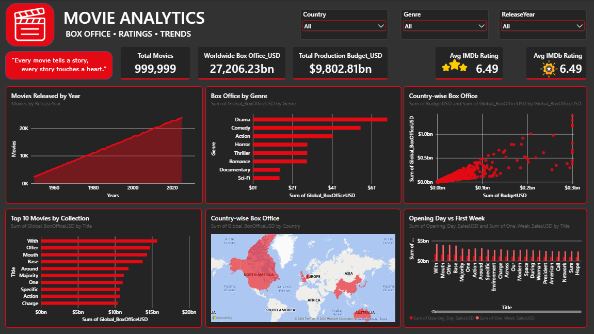

# 🎬 Movies House Analysis | Power BI Dashboard

## 📌 Project Overview

**Movies House Analysis** is an interactive Power BI dashboard designed to analyze movie industry data, worldwide box office performance, production budgets, audience ratings, and release trends. The dashboard transforms movie data into meaningful visual insights through interactive charts, KPI cards, and dynamic slicers.

## 🎯 Project Objectives

- Analyze movie releases over time.
- Evaluate worldwide box office revenue by genre and country.
- Identify the top 10 movies by box office collection.
- Explore the relationship between production budgets and worldwide revenue.
- Compare IMDb ratings with Rotten Tomatoes scores.
- Compare opening-day sales with first-week sales.
- Analyze movie industry performance through interactive visualizations.

## 📊 Dashboard Features

### 1. KPI Cards
- Total Movies
- Worldwide Box Office Revenue
- Total Production Budget
- Average IMDb Rating
- Average Rotten Tomatoes Score

### 2. Interactive Visualizations
- **Movies Released by Year:** Tracks movie release trends over time.
- **Box Office by Genre:** Compares worldwide revenue across movie genres.
- **Top 10 Movies by Collection:** Highlights the highest-grossing movies.
- **Country-wise Box Office:** Explores geographic revenue distribution.
- **Budget vs Collection:** Examines the relationship between production costs and box office revenue.
- **IMDb vs Rotten Tomatoes Ratings:** Compares movie rating metrics.
- **Opening Day vs First Week:** Compares early box office performance.

### 3. Interactive Filters
Users can filter dashboard insights by:
- Country
- Genre
- Release Year

## 🛠️ Tools & Technologies

- Microsoft Power BI Desktop
- Power Query
- DAX (Data Analysis Expressions)
- Data Visualization
- Interactive Dashboard Design

## 📈 Key Analytical Areas

- Movie industry performance analysis
- Worldwide box office revenue analysis
- Genre and country-level comparisons
- Movie rating analysis
- Production budget and revenue relationships
- Movie release trends

## 📂 Project Files

- `Movies_House_Analysis.pbix` – Power BI dashboard project file
- `README.md` – Project documentation
- Dashboard screenshot – Visual preview of the report

*Note: File names may vary depending on the files uploaded to the repository.*

## 🖼️ Dashboard Preview

Add your dashboard screenshot to the repository and update the image path below:

## 💡 Skills Demonstrated

Power BI Reporting | Data Visualization | DAX Measures | Power Query | KPI Development | Interactive Filtering | Business Intelligence | Data Analysis

## 👨‍💻 Author

**Shivam**

Aspiring Data Analyst | Power BI | Excel | SQL | Data Visualization

---

⭐ If you find this project interesting, feel free to explore the repository and share your feedback.
